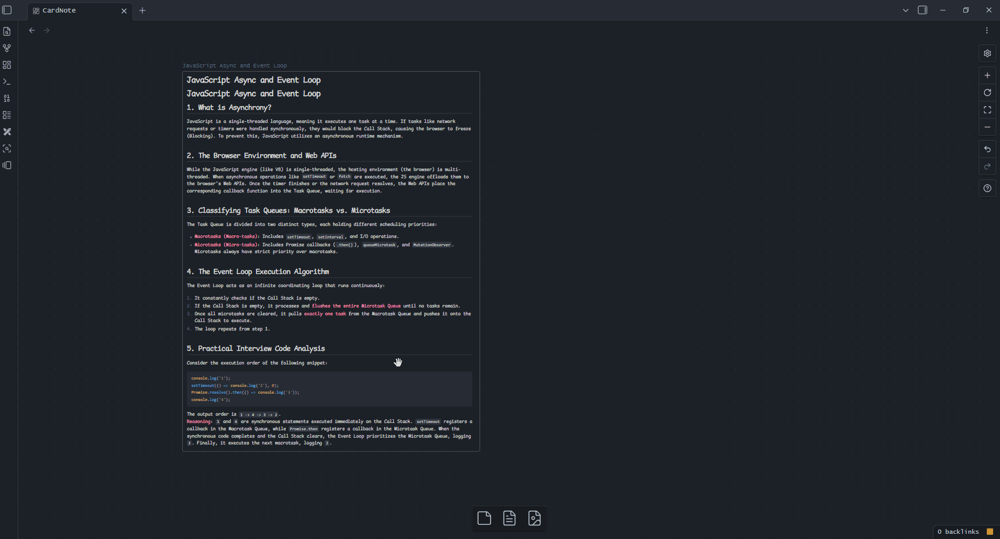
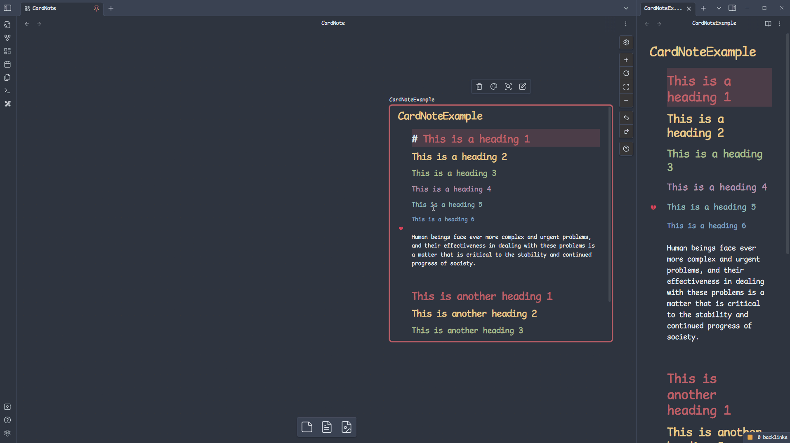
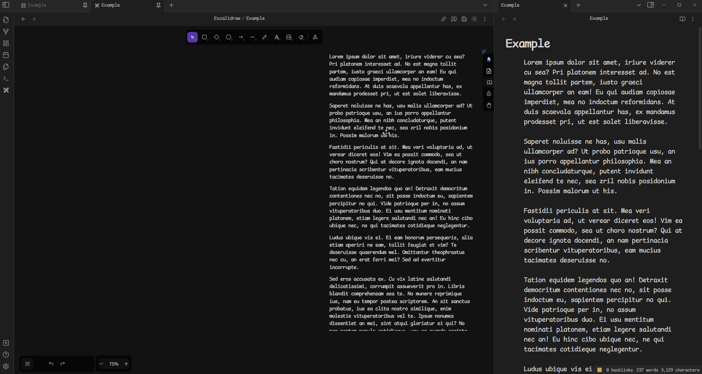

<h1 align="center">
	CardNote
</h1>

  
  
  
   
	
	
    
  <strong>⚡ Turn thoughts into connected visual notes.</strong>

CardNote helps you extract ideas from the editor and turn them into linked notes on [Obsidian Canvas](https://obsidian.md/canvas) or [Excalidraw](https://github.com/zsviczian/obsidian-excalidraw-plugin).

Drag a block, drop it onto your board, and keep thinking without breaking your flow.

## Why CardNote?

- **Capture ideas without breaking your flow**: Drag a heading, paragraph, list, or selected text directly from the editor.
- **Build visual notes faster**: Create a new note from the content you want to keep and place it on Canvas or Excalidraw.
- **Keep context connected**: Automatically draw a link between the source card and the extracted note.
- **Explore notes side by side**: Open the selected Canvas file node in a split view with Auto Preview.
- **Browse your vault visually**: Search notes with the built-in Cards View.

## Get Started

1. Install CardNote from Obsidian Community Plugins.
2. Open a note in the editor and find the drag symbol beside a block.
3. Drag the block onto an Obsidian Canvas or Excalidraw.
4. CardNote creates a linked note and connects it to the source.

## Features

### Obsidian Canvas

Create notes from editor content, place them on Canvas, and automatically connect them with configurable arrows and labels.

### Excalidraw

Use the same drag-and-drop workflow while sketching and organizing ideas in Excalidraw.

### Cards View

Search and browse your notes in a visual card layout.

## Commands

| Command | Description |
| --- | --- |
| Enable/Disable Auto Link | Automatically connect the extracted note to the source card on Canvas. |
| Arrow to * | Choose an arrow pointing from the source, to the target, in both directions, or no arrow. |
| Set Default Label| Add a label to automatically created links. |
| Show/Hide Drag Symbol | Show or hide the editor drag handle. |
| Enable/Disable Auto Preview | Open the selected Canvas file node in a split view. |

## Requirements

- Obsidian 1.13.7 or later
- Obsidian Canvas for Canvas workflows
- The Excalidraw community plugin for Excalidraw workflows

## Support CardNote

## License

[MIT](./LICENSE)